# Tres Regiones: Tierra en Ruinas
### Game Design Document (GDD) — v1.0

---

## 1. Portada y Ficha Técnica (High Concept)

| Campo | Detalle |
|---|---|
| **Título** | Tres Regiones: Tierra en Ruinas |
| **Integrante / rol** | Génesis Daena Vásconez Escobar — diseño de juego, programación, arte, audio y documentación (trabajo individual) |
| **Género** | Runner 2D de acción con desplazamiento lateral automático (*auto-runner*) |
| **Plataforma** | Navegador web (PC, teclado). Publicación en GitHub Pages e itch.io |
| **Público objetivo** | 13 a 25 años; jugadores casuales de juegos de correr y de acción (sesiones de 5 a 10 min) |
| **Estilo visual** | 2D vectorial plano, paisajes ecuatorianos de colores vivos sobre una atmósfera oscura de ruina |
| **Motor** | Phaser 3 (JavaScript) |
| **Duración del prototipo** | 4 niveles jugables, ~90–120 s cada uno |

**Elevator Pitch**

> Quito ha caído ante los Colosos y Ecuador quedó incomunicado. Como Aru, mensajero de la Guardia Cóndor, corres, saltas y combates por Atacames, Ambato, Baños y Misahuallí para recuperar tres componentes y reactivar la red de rescate. Cada civil que salvas te acompaña y puede salvarte a ti.

---

## 2. Pilares de Diseño y Experiencia (Enfoque MDA)

### 2.1 Tres pilares (reglas innegociables)

1. **El mundo nunca se detiene.** La carrera es automática; el jugador decide *cuándo* y *cómo* reaccionar (saltar, deslizar, atacar), nunca *si* avanza. Toda mecánica debe poder ejecutarse sin frenar.
2. **Ecuador es el protagonista.** Cada región cambia los obstáculos, el color y el ritmo del nivel. Un nivel no puede transplantarse a otra región sin perder sentido.
3. **Cada rescate cuenta.** Los civiles rescatados dan una ventaja jugable concreta (absorben un golpe) y se reflejan en la escena final. Salvar gente tiene que importar tanto como llegar a la meta.

### 2.2 Análisis MDA

| Capa | Contenido |
|---|---|
| **Mecánicas** | Auto-run, salto variable y doble salto, deslizamiento, ataque con espada, rescate por contacto, aliados que absorben daño, jefes con patrón. |
| **Dinámicas** | El jugador lee el terreno por adelantado, decide entre esquivar o atacar, arriesga una ruta alta para rescatar a alguien, y gestiona su salud con la ayuda de los aliados. |
| **Estéticas (emoción buscada)** | **Tensión y urgencia** (la velocidad sube cada nivel), **dominio** (aprender el patrón del jefe), **descubrimiento** (conocer regiones de Ecuador) y **empatía** (proteger a los rescatados). |

---

## 3. Core Loop y Mecánicas

### 3.1 Diagrama del Core Loop

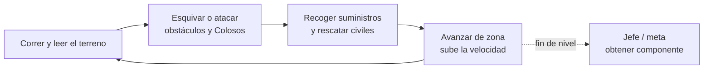

**Segundo a segundo (3–5 s):** el jugador ve un obstáculo, decide saltar, deslizar o atacar y vuelve a leer el terreno.
**Minuto a minuto (60–120 s):** recorre un nivel con 3 zonas de dificultad creciente, rescata civiles, llega al jefe o a la meta y consigue el componente.
**Meta de la sesión:** completar los niveles, superando su propia distancia récord.

### 3.2 Tabla de mecánicas principales

| Mecánica | Input | Regla | Feedback al jugador |
|---|---|---|---|
| **Correr** | Automático | Velocidad inicial 320 px/s; aumenta gradualmente hasta 560 px/s (según el nivel). Cada 60 px equivalen a 1 m de distancia. | Parallax del fondo más rápido, líneas de velocidad al superar 500 px/s. |
| **Saltar** | `Espacio` / `↑` / clic | Salto con impulso inicial; permite un segundo salto en el aire (2 saltos máximos). Se reinicia al tocar el suelo. | Estiramiento del personaje, sonido de impulso, polvo al aterrizar. |
| **Deslizarse** | `↓` / `S` | Reduce la caja de colisión a la mitad durante 0,6 s; permite pasar bajo estructuras colgantes. Enfriamiento de 0,3 s. | Personaje agachado, estela de polvo, sonido de roce. |
| **Atacar** | `X` / `Z` / `Shift` / clic derecho / botón | Golpe de espada con alcance de 150 px al frente; elimina Colosos pequeños de un golpe y daña jefes (1 de daño). Enfriamiento de 0,35 s. También disponible con `Z`, `K`, `J`, `Shift` y con un botón en pantalla. | Arco de luz de la espada, vibración corta de cámara, partículas al impactar. |
| **Rescatar** | Automático (contacto) | Tocar a un civil lo convierte en aliado. Máximo 2 aliados a la vez. Cada aliado **absorbe 1 golpe** y luego se retira a un punto seguro. | Aparece el civil junto al jugador, sonido de campana, contador de aliados sube. |
| **Recoger** | Automático (contacto) | Los suministros (*víveres*) suman puntos; los **componentes de comunicación** son objetivos de misión. | Brillo ámbar, sonido de moneda; el componente muestra un destello grande y un contador `n/3`. |
| **Decidir** *(Should)* | `↑` / `↓` en la bifurcación | Aparecen dos rutas: **alta** (más civiles, más peligro) o **baja** (más rápida, menos recompensa). Hay 3 s para elegir; si no se elige, se toma la baja. | Flechas parpadeantes y el tiempo se ralentiza 20 % durante la elección. |

### 3.3 Condiciones de victoria y derrota

| | Condición | Qué ocurre |
|---|---|---|
| **Victoria de nivel** | Llegar a la meta (o derrotar al jefe del nivel) y recoger el componente. | Pantalla de resumen: distancia, civiles salvados, componente obtenido. |
| **Victoria de la campaña** | Reunir los 3 componentes, derrotar al Coloso Apu y activar la red en Misahuallí. | Escena final cuyo texto cambia según los civiles rescatados. |
| **Victoria del juego** | Completar los 4 niveles, vencer al Coloso Apu y reactivar la red. | Pantalla final cuyo texto cambia según los civiles rescatados y los componentes reunidos. |
| **Derrota** | Quedarse sin corazones (3 al inicio). | *Game Over*; se reintenta desde el último punto de control (mitad del nivel) o desde el inicio. |

**Daño:** obstáculo o Coloso = −1 corazón, con 1,5 s de invulnerabilidad después de cada golpe. Si hay aliado, este absorbe el golpe y el jugador no pierde corazón.

---

## 4. Narrativa, Mundo y Personajes

### 4.1 Premisa y contexto

Durante generaciones, Ecuador convivió con los **Colosos**, criaturas gigantes que nacieron de la ceniza de los volcanes. La **Guardia Cóndor**, una organización de exploradores y mensajeros, protegía los asentamientos a través de una red de comunicación que conectaba las cuatro regiones. Una noche, una horda de Colosos cruza las barreras y arrasa **Quito**: el cuartel de la Guardia queda enterrado y la red se apaga. Sin comunicación, ningún pueblo puede coordinar defensas ni evacuaciones.

Los últimos comandantes encargan a **Aru Chasqui**, el mensajero más veloz de la Guardia, reunir tres componentes escondidos en Atacames, Ambato y el Pailón del Diablo, y llevarlos a la estación de Misahuallí. Allí debe vencer al Coloso Apu y reactivar la red. El final depende de a cuántas personas logró salvar en el camino.

### 4.2 Personaje principal

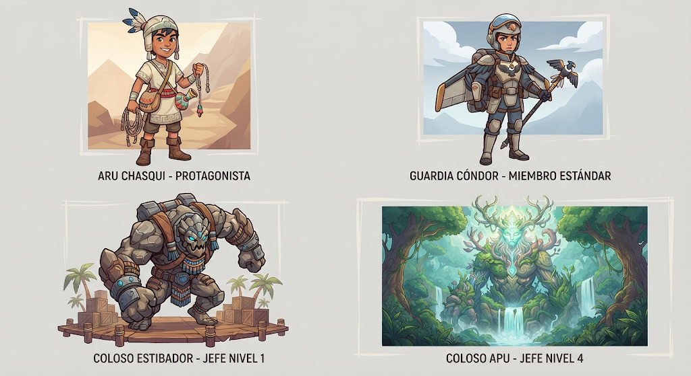

*Arte conceptual: Aru Chasqui, un miembro estándar de la Guardia Cóndor, el Coloso Estibador (jefe del Nivel 1) y el Coloso Apu (jefe del Nivel 4). Los sprites del juego son versiones simplificadas de estos diseños.*


| | |
|---|---|
| **Aru Chasqui** | Mensajero de la Guardia Cóndor. **Aspecto:** joven mensajero con diadema de plumas, túnica clara, morral y una soga. **Motivación:** restablecer la red para que su gente no quede aislada. **Habilidades:** correr, doble salto, deslizarse y atacar con una espada corta. Todas las habilidades están disponibles desde el Nivel 1. |

### 4.3 Enemigos y NPCs

Todos los Colosos son **gigantes de piedra con ojos cian brillantes**: es la señal visual de que se pueden atacar. Los obstáculos, en cambio, son de madera o ladrillo con franjas amarillas y negras: esos solo se esquivan.

| Entidad | Rol | Comportamiento / patrón |
|---|---|---|
| **Coloso Errante** | Enemigo básico (Niveles 1–2) | Camina hacia el jugador a 120 px/s por el suelo. Se elimina de un golpe. Contacto = −1 corazón. |
| **Coloso Trepador** | Enemigo aéreo (Nivel 2) | Cuelga de estructuras. Cuando el jugador está a menos de 250 px, se deja caer sobre el carril. Se esquiva con deslizamiento o salto, no se puede atacar mientras cuelga. |
| **Coloso Estibador** | Jefe del Nivel 1 | Lanza una caja cada 3 s, siempre precedida por un destello rojo de 0,8 s. Caja baja: se salta. Caja alta: se desliza. Tras 3 cajas queda aturdido 3 s y puede recibir daño (5 golpes para vencerlo). Por debajo del 50 % de vida lanza 2 cajas seguidas. |
| **Coloso Cañón** | Jefe del Nivel 3 | Lanza rocas bajas (se saltan) y abre **huecos** en el camino (se saltan con ritmo). Destello rojo de 0,8 s antes de cada ataque. Tras 3 ataques queda aturdido 3 s (6 golpes para vencerlo). Con poca vida encadena dos ataques. |
| **Coloso Apu** | Jefe final (Nivel 4) | Combina troncos bajos, rocas altas, huecos y un **barrido** de liana que obliga a deslizarse. 7 golpes para vencerlo; con poca vida encadena dos ataques distintos. |
| **Civiles y exploradores** | NPC rescatables | Esperan en plataformas o en el carril. Al ser rescatados acompañan a Aru y absorben un golpe. |

---

## 5. Diseño de Niveles y Progresión

### 5.1 Estructura de niveles

| Nivel | Región | Objetivo | Estado en el alcance |
|---|---|---|---|
| **1. Atacames** | Costa | Cruzar playas y calles destruidas, vencer al Coloso Estibador y obtener el **componente 1**. | **Must** |
| **2. Ambato — Laberinto de los Tres Juanes** | Sierra | Atravesar el laberinto (ficticio) y obtener el **componente 2**. | **Must** |
| **3. Pailón del Diablo** | Sierra (Baños) | Cruzar senderos y puentes colgantes, vencer al Coloso Cañón y obtener el **componente 3**. | **Must** (implementado) |
| **4. Puerto Misahuallí** | Amazonía | Cruzar la selva, vencer al Coloso Apu y activar la red. | **Must** (implementado) |

Cada nivel mide ~600 m (90–120 s a la velocidad del juego).

### 5.2 Curva de dificultad

| Nivel | Mecánica o reto nuevo | Velocidad inicial → final |
|---|---|---|
| 1. Atacames | **Tutorial implícito:** saltar obstáculos bajos, deslizarse bajo estructuras, atacar al Coloso Errante, rescatar civiles. Primer jefe con patrón fijo. | 320 → 450 px/s |
| 2. Ambato | Coloso Trepador (cae al acercarse), secciones que exigen combinar salto, deslizamiento y ataque. Las **bifurcaciones del laberinto** (decisión alta/baja) quedan como *Should*. | 380 → 520 px/s |
| 3. Pailón del Diablo | **Huecos** en el camino, rocas húmedas, jefe que exige ritmo de saltos. | 400 → 540 px/s |
| 4. Misahuallí | Troncos, huecos y Colosos Trepadores combinados; jefe final con cuatro ataques y dos fases. | 420 → 560 px/s |

### 5.3 Boceto del Nivel 1 (Atacames)

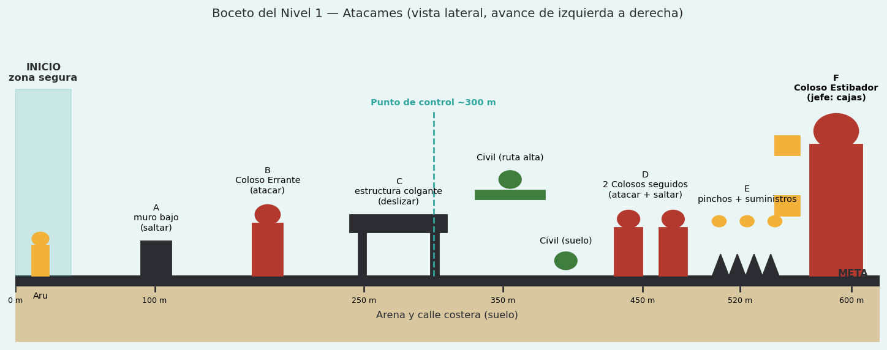

| Marca | Elemento | Función |
|---|---|---|
| **▶** | Inicio | Zona segura, 3 s sin enemigos. |
| **A** | Obstáculo bajo (muro roto) | Enseña el salto. |
| **B** | Coloso Errante `☠` | Enseña el ataque. |
| **C** | Estructura colgante `▓` | Enseña el deslizamiento. |
| **♥** | Civil | Enseña el rescate. Se puede tomar en plataforma elevada (riesgo) o en el suelo. |
| **D** | Dos Colosos seguidos | Primera prueba de combinar ataque y salto. |
| **E** | Pinchos `▲` y suministros | Zona de recolección con riesgo. |
| **F** | Coloso Estibador | Jefe. Al vencerlo suelta el **componente 1** y termina el nivel. |
| **Punto de control** | ~300 m | Reaparición tras una derrota. |

---

## 6. Dirección de Arte, Audio y UI/UX

### 6.1 Arte

**Estilo:** 2D vectorial caricaturesco, con contornos oscuros gruesos, colores vivos y siluetas claras. Los fondos tienen cuatro capas de parallax (cielo fijo, nubes, paisaje lejano y paisaje cercano) más el suelo, con colores amables para que el jugador lea bien lo que importa. La ruina se sugiere con detalles (un faro agrietado, una casa sin techo, una torre rota) sin oscurecer la escena. Cada región se identifica a la primera por su paleta y su silueta: palmeras y mar (Costa), cerros y tejas (Sierra), cascada y niebla (Baños), vegetación densa (Amazonía).

**Lenguaje visual (cómo leer el peligro)**

| Qué se ve | Qué significa | Qué hace el jugador |
|---|---|---|
| Gigante de piedra con ojos cian brillantes | **Coloso** (enemigo) | Atacar (`X`) o esquivar |
| Madera o ladrillo con franjas amarillas y negras | **Obstáculo** | Saltar o deslizarse |
| Persona con aura verde | **Civil** | Tocarlo para rescatarlo |
| Bananos y cristal dorado con brillo | **Suministro** y **componente** | Recoger |

Además, la primera vez que aparece cada tipo de objeto, el juego muestra una etiqueta flotante (por ejemplo, «¡DESLIZA!» o «¡ATACA!») para enseñarlo sin un tutorial aparte.

**Hoja de arte del juego**

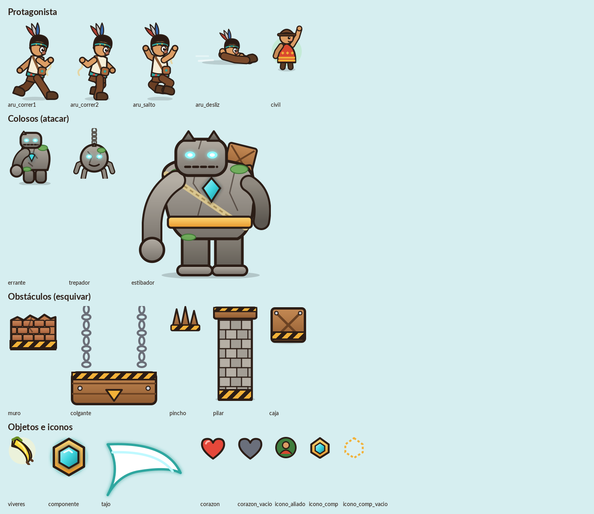

**Paleta principal**

| Color | Hex | Uso |
|---|---|---|
| Ceniza | `#2B2D33` | Fondos oscuros, ruinas, siluetas de Colosos. |
| Rojo alerta | `#B3392F` | Peligro, telegrafía de ataques, daño. |
| Turquesa costa | `#2FA7A0` | Nivel 1, UI de información. |
| Verde selva | `#3E7D3C` | Niveles 3 y 4, civiles y aliados. |
| Ámbar | `#F2B138` | Suministros, componentes, botones principales. |

**Moodboard (referencias de diseño)**

| Atacames (Costa) | Ambato (Sierra) |
|:---:|:---:|
| 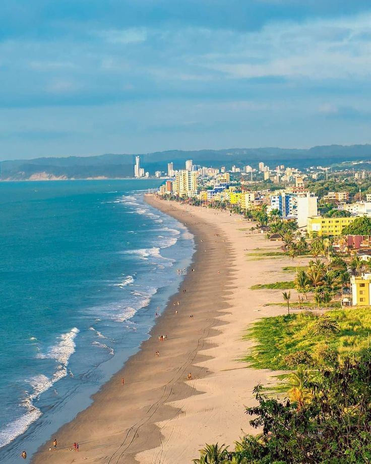 | 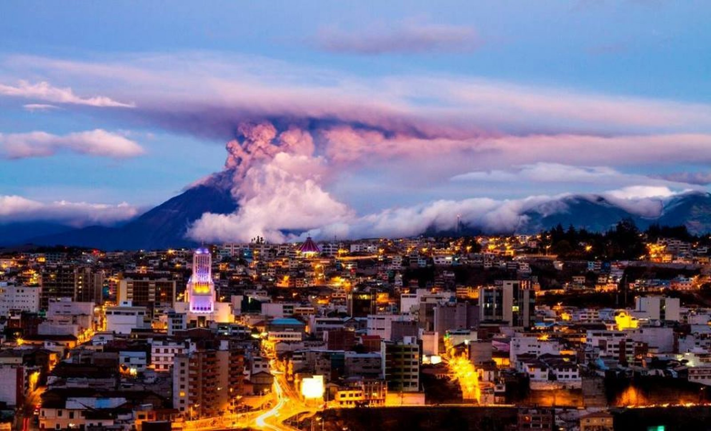 |
| Mar turquesa, arena y palmeras. Define el Nivel 1. | Ciudad entre montañas, tejados y cielo abierto. Define el Nivel 2. |

| Pailón del Diablo (Baños) | Misahuallí (Amazonía) |
|:---:|:---:|
| 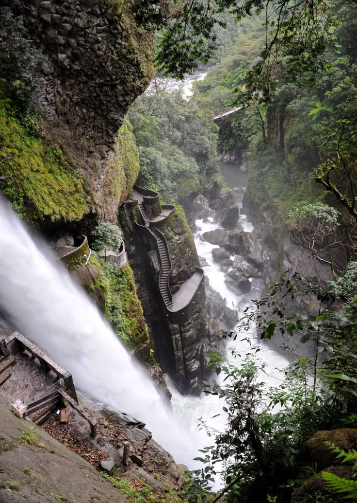 | 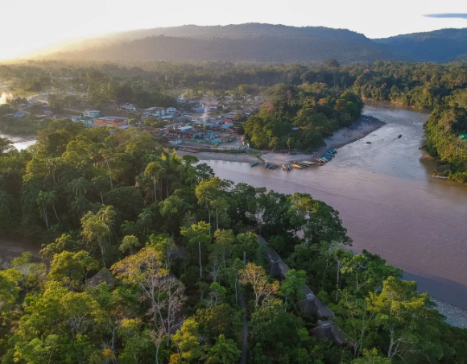 |
| Cascada, roca húmeda y vegetación. Define el Nivel 3. | Selva densa y río. Define el Nivel 4. |

**Otras referencias de diseño**

| Referencia | Qué se toma de ella |
|---|---|
| *Banana Kong* (runner 2D) | Lectura clara de obstáculos, ritmo y sensación de velocidad. |
| Ambientación de ruina post-apocalíptica en 2D | Atmósfera oscura, con luz cálida únicamente en los objetos importantes. |

Los paisajes se simplifican a formas planas y se les aplica la paleta definida arriba, para que las cuatro regiones se distingan de un vistazo.

### 6.2 Audio

**Música (BGM):** una pista en bucle por región, con instrumentos andinos y percusión que acelera con la velocidad.

| Escena | Estilo |
|---|---|
| Menú | Flauta de pan y cuerdas lentas, tono épico y melancólico. |
| Nivel 1 | Ritmo costeño con percusión ligera. |
| Nivel 2 | Charango y bombo, ritmo medio. |
| Jefe | Percusión intensa, sin melodía. |
| Victoria / Derrota | Jingles cortos (3–5 s). |

**Efectos de sonido (SFX) clave:**
salto, doble salto, aterrizaje, deslizamiento, golpe de espada, impacto en Coloso, daño al jugador, recoger suministro, recoger componente, rescate (campana), aviso del jefe, clic de botón, victoria, derrota.

### 6.3 UI / HUD

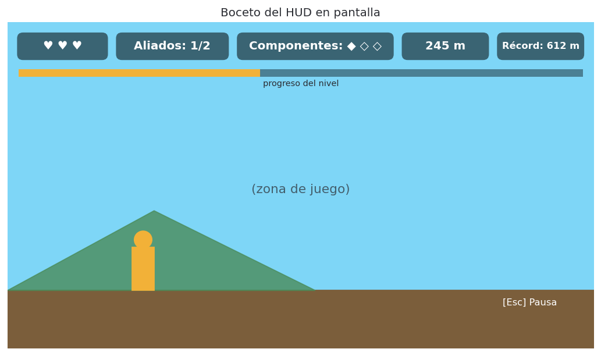

| Elemento | Dato mostrado |
|---|---|
| Corazones | Vida (3 al inicio). |
| Aliados | Civiles que acompañan al jugador (máx. 2). |
| Componentes | `n/3` obtenidos. |
| Distancia y récord | Metros recorridos y mejor marca guardada en el navegador. |
| Barra de progreso | Avance hacia la meta del nivel. |

**Flujo de menús:**

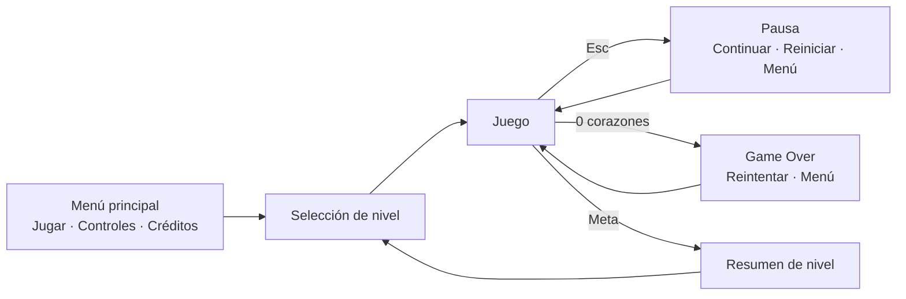

---

## 7. Alcance Técnico y Plan de Producción (MVP)

### 7.1 Motor y herramientas

| Categoría | Elección |
|---|---|
| Motor | Phaser 3.80 (JavaScript), física Arcade |
| Código | Visual Studio Code |
| Arte | Ilustraciones vectoriales (SVG) generadas con el script `tools/arte` y exportadas a PNG con la librería `sharp`; las fuentes SVG se guardan en `assets/fuentes/` |
| Audio | jsfxr (efectos) y música libre de derechos (pendiente) |
| Repositorio | GitHub (`2026B-sof-jueg-gr1/vasconez-escobar-genesis-daena-jueg-gr1`) |
| Publicación | GitHub Pages (automática por GitHub Actions) e itch.io (versión HTML5 en ZIP) |

**Estructura del repositorio**

```
├── GDD.md                  Documento de diseño (entrega del examen)
├── README.md               Cómo ejecutar el juego
├── index.html              Punto de entrada del juego
├── landing/                Página de presentación del juego (con capturas)
├── assets/
│   ├── sprites/            Personajes, Colosos, obstáculos e iconos (PNG)
│   ├── fondos/             Cielo, nubes, paisajes y suelo de cada región (PNG)
│   └── fuentes/            Archivos SVG originales
├── src/
│   ├── datos/              Configuración, niveles y catálogo de imágenes
│   ├── sistemas/           Récord y progreso
│   └── escenas/            Pantallas: carga, menú, niveles y juego
├── docs/                   Imágenes del GDD (concepto, moodboard, bocetos, capturas)
├── tools/arte/             Script que genera las imágenes
└── .github/workflows/      Publicación automática en GitHub Pages
```

**Punto de partida:** el repositorio ya contenía un prototipo en Phaser con correr automático, doble salto, obstáculos, objetos recolectables, parallax, HUD, menú y récord guardado. Ese código se adaptó a este diseño.

### 7.1.1 Estado actual del prototipo

Todo lo marcado como *Must have* en la matriz siguiente está implementado y jugable en `index.html`:

| Elemento | Estado |
|---|---|
| Correr automático, salto y doble salto, deslizamiento, ataque | Hecho |
| Vida (3 corazones), invulnerabilidad, derrota y punto de control (300 m) | Hecho |
| Civiles rescatables y aliados que absorben un golpe | Hecho |
| Nivel 1 Atacames con Coloso Errante y jefe Coloso Estibador (2 fases) | Hecho |
| Nivel 2 Ambato con Coloso Trepador y obstáculos propios | Hecho |
| HUD, menú principal, selección de nivel, pausa, *Game Over* y resumen de nivel | Hecho |
| Nivel 3 Pailón del Diablo (huecos, Coloso Cañón) y Nivel 4 Misahuallí (Coloso Apu, final que cambia según los civiles rescatados) | Hecho |
| Botones en pantalla para atacar y deslizarse | Hecho |
| Landing page de presentación (`landing/index.html`) | Hecho |
| Bifurcaciones, música y SFX | Pendiente (*Should*) |

| Menú principal | Nivel 1: Atacames |
|:---:|:---:|
| 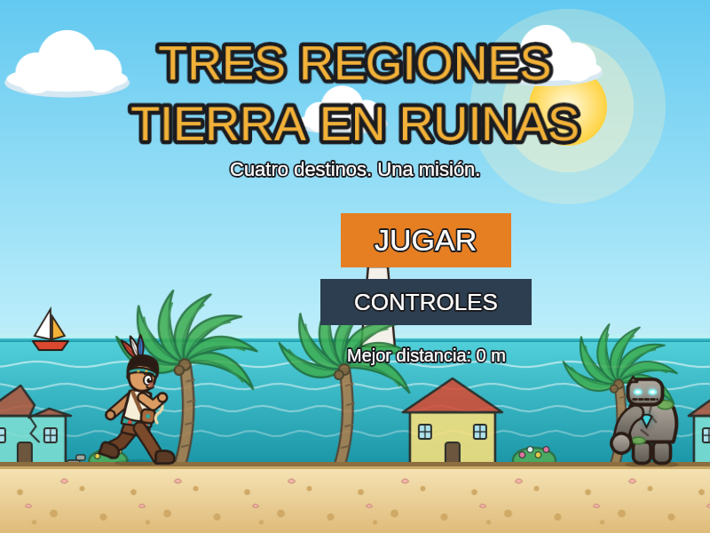 | 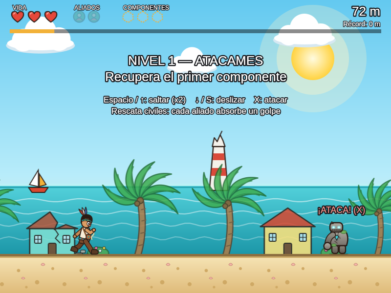 |
| **Jefe: Coloso Estibador** | **Nivel 2: Ambato** |
| 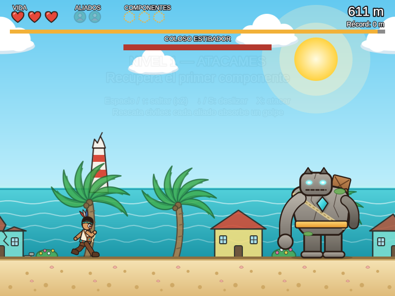 | 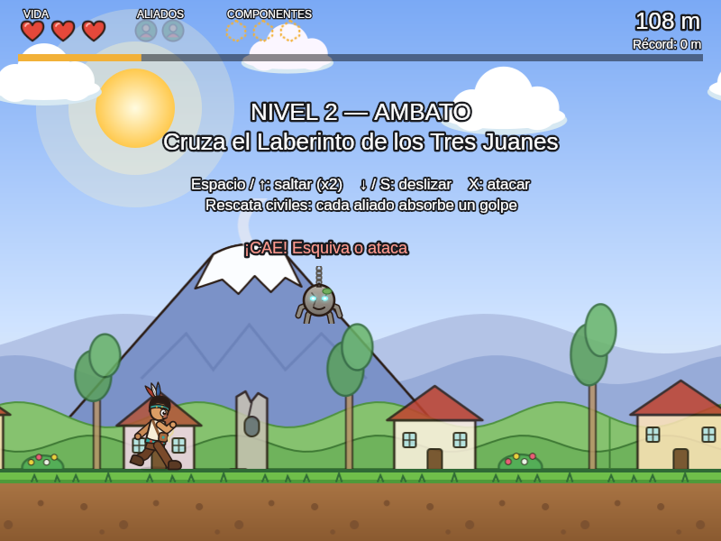 |
| **Rescate de un civil** | **Selección de nivel** |
| 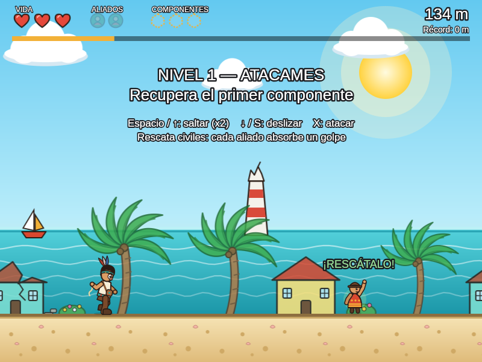 | 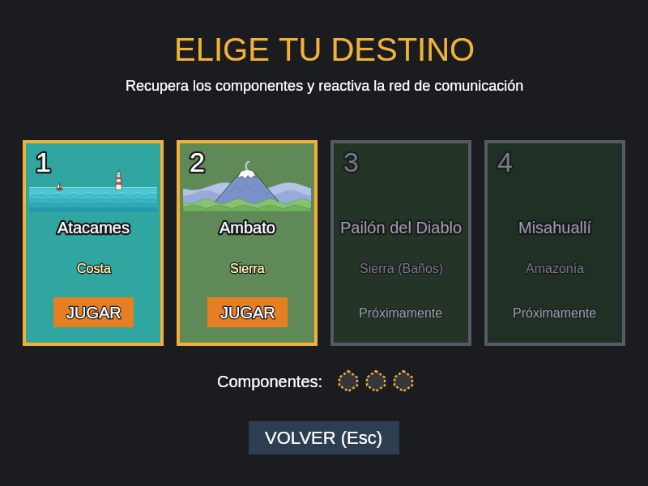 |
| **Nivel 3: Pailón del Diablo (hueco)** | **Jefe: Coloso Cañón** |
| 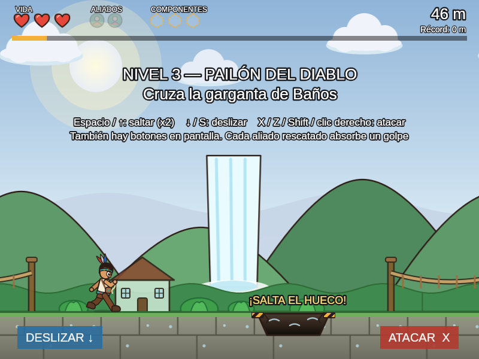 | 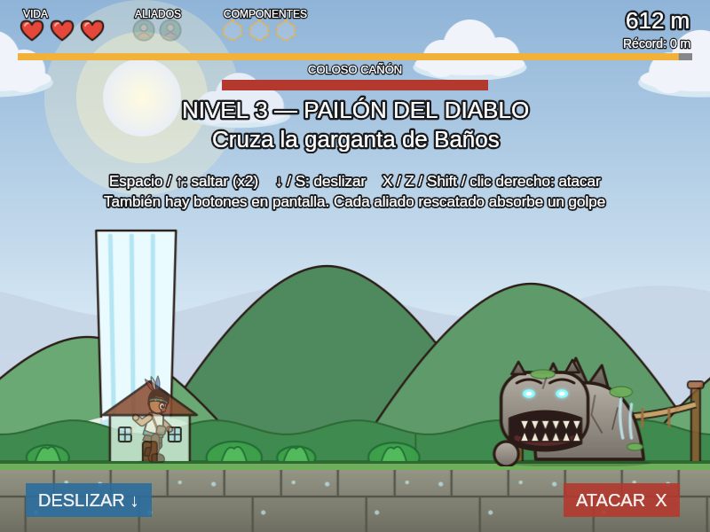 |
| **Nivel 4: Misahuallí** | **Jefe final: Coloso Apu** |
| 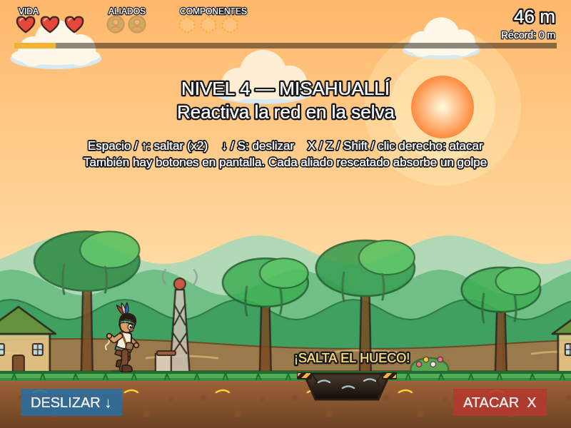 | 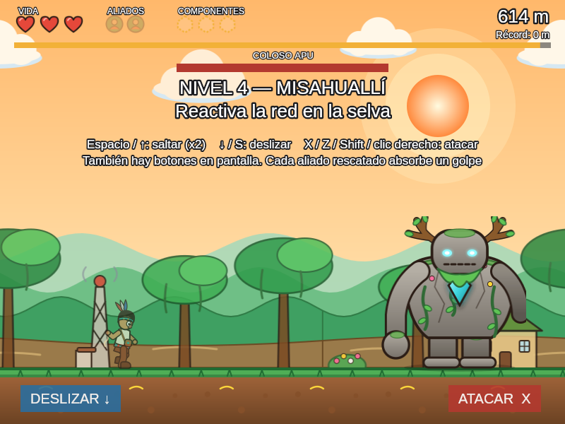 |


### 7.2 Matriz MoSCoW

| Prioridad | Elementos |
|---|---|
| **Must have** (imprescindible, ya implementado) | Correr automático con velocidad creciente · Saltar y doble salto · Deslizarse · Atacar · Nivel 1 (Atacames) con Coloso Errante y jefe Estibador · Nivel 2 (Ambato) con Coloso Trepador · Nivel 3 (Pailón del Diablo) con jefe Cañón · Nivel 4 (Misahuallí) con jefe final Apu y final variable · Rescate de civiles con aliado que absorbe un golpe · Recoger el componente · Vida, victoria y derrota con reintento · HUD y menús básicos (inicio, pausa, game over) · Arte provisional con la paleta definida |
| **Should have** (deseable) | Sistema de bifurcaciones (Decidir) · Música por región y SFX completos |
| **Could have** (si sobra tiempo) | Pantalla de selección de nivel con mapa de Ecuador · Controles táctiles para celular · Galería de logros |
| **Won't have** (fuera de esta versión) | Varios personajes jugables · Árbol de decisiones con múltiples finales · Multijugador · Descargable para PC o móvil · Generación aleatoria de niveles |

### 7.3 Plan de producción

| Fase | Entregable |
|---|---|
| 1 | GDD completo (este documento). |
| 2 | Adaptar el prototipo: ataque, deslizamiento, vida, aliados y HUD. **(Hecho)** |
| 3 | Nivel 1 completo con jefe. **(Hecho)** |
| 4 | Niveles 2, 3 y 4 con sus jefes y el final variable **(hecho)**; pulido de sonido (pendiente). |
| 5 | Landing page y publicación en itch.io. |

---
*Documento sujeto a cambios mientras se desarrolla el prototipo. Versión 1.0.*
